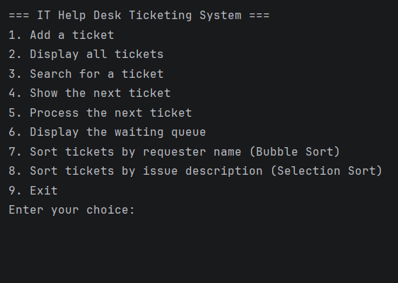

# IT Help Desk Ticketing System

## Project Description

The IT Help Desk Ticketing System is a console-based Java program for recording
IT support requests. Users can add tickets, search for them, and manage a
waiting queue. The queue follows the First In, First Out (FIFO) rule: the
first ticket added is the first ticket processed.

The program also includes sorting features so users can view tickets in
alphabetical order by requester name or issue description.

## Objectives

- Store ticket numbers, requester names, and issue descriptions.
- Add tickets to a waiting queue and process them in arrival order.
- Search for a ticket by ticket number.
- Display waiting tickets separately from processed tickets.
- Use Bubble Sort and Selection Sort to organize ticket records.
- Handle invalid input and empty queues with messages.

## Features

- Add a ticket with a requester name and issue description.
- Assign each ticket a number automatically.
- Display waiting and processed tickets in separate sections.
- Search for a ticket by its number.
- Peek at the next ticket without removing it from the queue.
- Process the next ticket in the waiting queue.
- Display the waiting queue.
- Sort ticket records by requester name using Bubble Sort.
- Sort ticket records by issue description using Selection Sort.
- Reject blank ticket names and issue descriptions.
- Handle non-number menu and search input.

## Data Structures

The program uses three parallel `ArrayList`s to store ticket records:

- `ticketNumbers` stores ticket numbers.
- `requesterNames` stores requester names.
- `issueDescriptions` stores issue descriptions.

The values at the same index belong to the same ticket. For example, the
ticket number, requester name, and issue description at index `0` describe
the first ticket.

A `Queue<Integer>` stores the numbers of tickets that are waiting. New ticket
numbers are added to the back of the queue. Processing a ticket removes the
number at the front, which demonstrates FIFO behavior.

An `ArrayList<Integer>` named `processedTicketNumbers` stores the numbers of
processed tickets. The ticket details remain in the record lists, so they can
still be displayed or found using search.

## Sorting Algorithms

### Bubble Sort

Option 7 sorts tickets alphabetically by requester name. It compares
neighboring names and swaps them when they are out of order. When two names
are swapped, their ticket numbers and issue descriptions are swapped too, so
the details remain with the correct ticket.

### Selection Sort

Option 8 sorts tickets alphabetically by issue description. It finds the
alphabetically earliest issue in the unsorted portion of the list and moves
that ticket into the next position. It also moves the ticket number and
requester name so each record stays together.

Sorting changes the order of the stored ticket records. It does not change
the waiting queue, so tickets continue to be processed in arrival order.

## How to Run

### Run in IntelliJ IDEA

1. Open the project in IntelliJ IDEA.
2. Open `src/Main.java`.
3. Click the green Run icon beside the `main` method, or right-click the file
   and select **Run 'Main.main()'**.

### Run from a terminal

Open a terminal in the folder containing `Main.java`, then run:

```text
javac Main.java
java Main
```
### Screenshots

## *Figure 1. Main menu of the IT Help Desk Ticketing System.*



## *Figure 2. Two tickets are added to the waiting queue.*


## *Figure 3. Waiting tickets and processed tickets are displayed separately.*
### This is for the Display all tickets option (after processing 2 tickets)


## *Figure 4. All four tickets are waiting before any are processed.*


## *Figure 5. Searching for ticket #2 displays its requester and issue.*


## *Figure 6. The next ticket is shown without being removed from the queue.*
### This is after processing 1 ticket (which moves to ticket 2 to front)


## *Figure 7. The program reports that there are no tickets to process when the queue is empty.*


## *Figure 8. Ticket #1 is moved to the processed tickets.*
### From 5. Process the next ticket (Ticket 1 came first and processed first (FIFO))


## *Figure 9. Tickets #2, #3, and #4 remain in the waiting queue.*


## *Figure 10. Bubble Sort arranges the ticket records by requester name.*


## *Figure 11. Selection Sort arranges the ticket records by issue description.*
### Best when using list of categories, here, the categories are listed alphabetically


## *Figure 12. The program exits after the user selects option 9.*


## *Figure 13. The program requests a number when menu input contains text.*
### For Input validation


## *Figure 14. The program rejects a menu number outside the available choices.*
### For Input Validation


## *Figure 15. The program rejects a blank requester name.*
### For Input Validation

